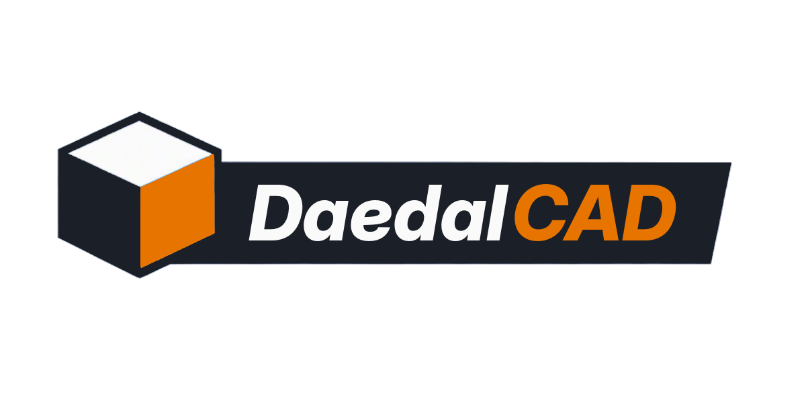

<h1 align="center"></h1>

DaedalCAD is a desktop 3D modeller for 3D printing, in the same spirit as TinkerCAD. Stack simple shapes, cut holes with other shapes, round off the edges, and send the result to your slicer. It runs as a native Windows program: no browser, no account, and no internet needed to design. Everything is in millimetres, with Z up.

The name comes from Daedalus, the legendary craftsman, and the word “daedal”: skilfully and intricately made. Up to version 0.9 it was called ShapeSynth.

## Modelling

Start from a shape and drag it onto the workplane, or just click it:

> cube · rounded box · sphere · dome · cylinder · cone · tube · capsule · torus · diamond (pointed or cut gem) · heart · hex prism · pyramid · wedge · roof · star (pointed or flat, any number of points) · text

Then shape it into what you need:

- **Holes:** any shape can be a hole. It cuts the solids in its own group (the bed counts as a group too). Give it some clearance, from your printer setting or per hole, and the matching part fits.
- **Move, rotate and scale** with the gizmo, or type exact numbers.
- **Workplanes:** put one on any face, even a slanted one, and new parts stand upright on it. **Lay flat** turns a clicked face onto the plate.
- **Line things up:** mirror, align (pick parts, then click a dot), measure, and drop onto the bed or onto another part.
- **Repeat** makes stepped copies, with a move, spin and scale each time.
- **Group, merge and combine:** group and ungroup, with full undo and redo. **Merge** makes a group one solid part (Unmerge brings it back), **Hull** shrink-wraps parts into one smooth solid or a chain, and **Intersect** keeps only what parts have in common.
- **Split** cuts a part in two with a plane, optionally with pin holes, pegs or a sliding dovetail to put it back together.
- **Threads:** any cylinder can be an ISO metric thread from M2 to M36, as a threaded rod or a threaded hole.
- **Text** in any font on your computer, straight or running along a curve.
- **See inside** with the section view along X, Y or Z. Overhangs that are too steep for printing show striped red.

## Shape tools

- **Fillets:** round outside corners, round the edges of a face you click (pocket rims, tube ends), or let **Detected edge filleting** (beta) find the sharp edges on anything, even merged groups, STLs and text, and round or chamfer the ones you pick.
- **Hollow** turns a part into a shell with even walls.
- **Lattice** turns it into a Voronoi skin, gyroid, honeycomb, Voronoi lattice, sponge, sponge walls or bubbles: open, or inside a solid skin. It builds in the background on every core, and smooths the result onto the true surface so slicers accept it.
- **Texture** adds knurling, ribs, hexagons, dots, wood grain, leather, carbon weave or your own picture as real geometry, raised or cut in, while the bottom stays flat.
- **Wrap** puts text or a logo onto a curved surface.
- **Bend, twist and taper:** bend a part into an arc or close it into a ring, wring it, or make one end narrower. **Bend face** and **Extrude face** work on a single face.
- **Articulate** cuts a part into segments with print-in-place joints: print a flexi dragon or snake flat.
- **Mold** makes a two-piece casting mould of a part, with a pour hole, air vents and keys.
- **Smooth join** makes the parts of a group blend into each other like clay.
- **Restyle** rebuilds something low-poly or from voxel cubes, and **Simplify** slims down heavy sculpts and STLs.

## Sculpting

Want something organic? The Sculpt window lets you push and pull a surface with brushes, much like Blender's Sculpt Mode. Start from a ball, cube, cylinder, slab or capsule, or sculpt a part you already have.

- Brushes: Draw, Clay, Layer, Inflate, Blob, Crease, Smooth, Flatten, Fill, Scrape, Grab, Snake hook, Pinch, Nudge, Rotate, Mask and Stamp.
- Ctrl reverses a brush, Shift smooths, and mirror or radial symmetry do both sides at once.
- The surface always stays a closed, printable solid: strokes that would push it through itself are held back.
- Remesh evens out the triangles at the detail you want.

Put the result in place of the selected part or next to it, double-click it later to keep sculpting, or save it to your library.

## Libraries

- **Parts:** your own parts and imported STLs, searchable by name or by tags you give them.
- **Sculpts** you saved from the Sculpt window.
- **2D shapes:** outlines with nodes, rectangles, circles, polygons, holes and layers, which extrude into solids. Placed shapes keep their own copy, and you can update them when the library version changes.
- **Generators:** parametric parts that keep their settings, and use your printer clearance where parts fit together. Boxes with lids (snap and seal options), Gridfinity bins and baseplates, screw-top jars, electronics enclosures, battery holders, watertight O-ring grooves, gears (spur, helical, herringbone), rack and pinion, hinges, ball joints, pulleys, bearing housings, shaft couplers, springs, latches, living hinges, cable chains, tube connectors, bit and tool holders, drawer dividers, cable clips, dice, lithophanes, hose adapters, pattern panels and tubes, and fit test pieces.
- **Standard parts:** ISO and DIN fasteners at real sizes from M2 to M24: screws with various heads, nuts, washers, dowel pins, threaded rod and heat-set inserts, with plain (fast) or modelled threads. Each comes with its matching hole (clearance, counterbore, countersink, tapped or nut trap), and **Add matching hole** puts it in the right spot for you.

## Export and more

- **STL** for one merged mesh. **OBJ** and **3MF** keep every part as its own named, coloured object, and groups can keep their part colours for multi-colour prints. **DXF** puts each part on its own layer.
- **STEP** for other CAD programs, with true curved surfaces for shapes, fillets, text, 2D shapes, threads and bends. You can import STEP files too.
- **Export slice** writes a flat DXF of one cut, for laser cutters and the like.
- **Technical drawings:** front, top, side and isometric views (first or third angle), hidden lines, dimensions, a title block and a filament estimate, as PDF, SVG, DXF or PNG.
- **The view:** a view cube, Home, perspective or orthographic, and isometric. Every tool and command has a keyboard shortcut you can change.
- **Projects** save as a folder, or as one portable `.daedal` file.
- **CloudSync** (optional) backs up your projects to a DaedalSync server and lets a group share designs. `webapp/README.md` explains how to host one.
- **Updates:** DaedalCAD checks the GitHub releases for a new version, and an installed copy updates itself.

## How it works

DaedalCAD is written in C++20, with Qt 6 for the interface and the OpenGL view, and Manifold for the solid geometry. OpenCASCADE adds the exact STEP export and import; the normal release includes it.

The scene is a flat list of nodes: shapes, holes, groups, text, 2D shapes, imported meshes and generators. The evaluator turns each one into a solid, cuts the holes, merges the groups, and then applies fillets and bends. Results are cached, so only what changed is rebuilt, and heavy work runs in the background on every core while the window stays responsive. Groups that only hold parts together draw straight from those parts, so grouping lots of pieces is instant; the real merge happens when you export.

Fillets are exact-radius, which makes them slow on purpose. About 32 curve segments and 12 fillet segments is a good balance. A fillet bigger than the part leaves the edge sharp.

## Building

On Windows, double-click `build-windows.bat` (or run `setup-windows.ps1`). It installs whatever is missing (Git, the Visual Studio Build Tools, CMake and Qt) and builds `build\Release\DaedalCAD.exe`. Add `step` for the build with exact STEP. [docs/install.md](docs/install.md) has the options and the manual steps.

## Community

Questions, ideas, or something you made with DaedalCAD? Come say hi on the [Discord server](https://discord.gg/Z8mMTZK6B6).

## License

DaedalCAD is free software under the GNU General Public License, version 3 ([LICENSE](LICENSE)). Forks and changes are welcome; anything you distribute that is built from this code must be shared under the same license, with its source.

The DaedalSync server in `webapp/` is under the GNU Affero General Public License, version 3. DaedalCAD builds on Qt (LGPL-3.0), Manifold and oneTBB (Apache-2.0), Clipper2 (Boost Software License) and OpenCASCADE (LGPL-2.1 with the Open CASCADE exception). Gridfinity is Zack Freedman's design, under the MIT license. [THIRD_PARTY_LICENSES.md](THIRD_PARTY_LICENSES.md) has the details and full license texts.
